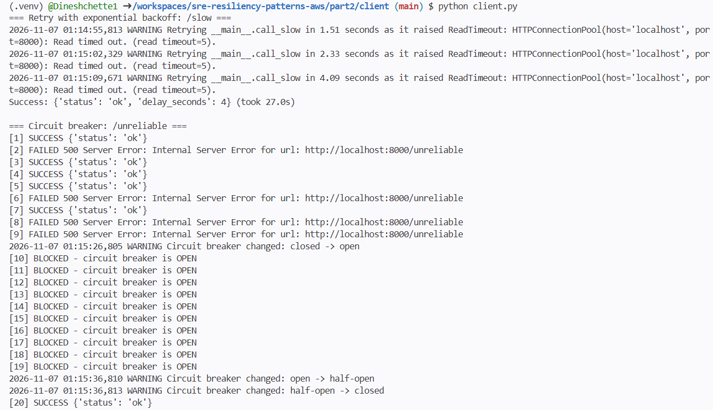
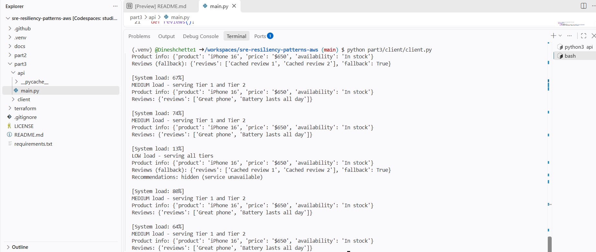
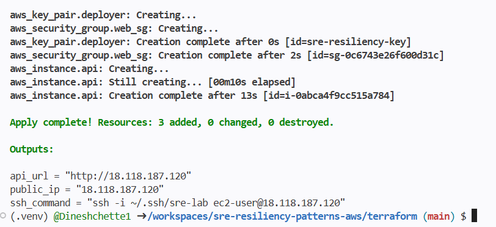
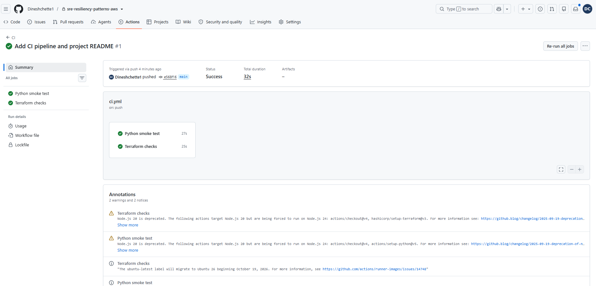

# SRE Resiliency Patterns on AWS


How to keep an application usable when its dependencies are slow, failing, or overloaded. Built with **FastAPI** and **Python**, deployed to **AWS EC2** with **Terraform**.

## What's inside

| Part | What it shows | Folder |
|---|---|---|
| 1 | Resiliency patterns, failure mode analysis, and a strategy for an e-commerce app | [`docs/`](docs/) |
| 2 | **Circuit Breaker** (pybreaker) and **Retry with Exponential Backoff + Jitter** (tenacity) | [`part2/`](part2/) |
| 3 | **Graceful degradation**: tiered features, fallbacks, and load shedding | [`part3/`](part3/) |
| Infra | EC2 + security group + key pair with Terraform, API runs as a systemd service | [`terraform/`](terraform/) |

## Architecture

```
            ┌────────────── AWS (us-east-2) ──────────────┐
 Client ──► │  Security Group (80 open, 22 my IP only)    │
 (Python)   │        │                                    │
            │        ▼                                    │
            │  EC2 t3.micro · Amazon Linux 2023           │
            │  FastAPI (uvicorn, systemd) on port 80      │
            └─────────────────────────────────────────────┘
```

## Part 2: Circuit Breaker + Retry

- `/healthy`: always works
- `/unreliable`: fails ~50% of the time → protected by a **circuit breaker** (opens after 3 failures, half-open after 10s)
- `/slow`: 1–10s delay → **retry** up to 5 times, exponential backoff with jitter, 5s timeout per try

## Part 3: Graceful Degradation

| Tier | Feature | Endpoint | If it fails |
|---|---|---|---|
| 1 Critical | Product info | `/product-info` | Always on |
| 2 Important | Reviews (~30% failure) | `/reviews` | Show cached reviews |
| 3 Nice-to-have | Recommendations (~70% failure) | `/recommendations` | Hide quietly |

**Load shedding** based on `/system-load`: over 80% → Tier 1 only · 60–80% → Tiers 1–2 · under 60% → all tiers.

## Screenshots

**Circuit breaker and retry:** retries with growing waits, then the breaker going closed → open → half-open → closed.



**Graceful degradation:** load shedding by CPU load, with cached reviews as a fallback.



**Deployed to AWS with Terraform:**



**CI pipeline passing:**



## Run locally

```bash
python3 -m venv .venv && source .venv/bin/activate
pip install -r requirements.txt

# Terminal 1
cd part2/api && uvicorn main:app --port 8000
# Terminal 2
cd part2/client && python client.py
```

Same for `part3/`.

## Deploy to AWS

```bash
ssh-keygen -t ed25519 -f ~/.ssh/sre-lab -N ""
cd terraform
terraform init
terraform apply
BASE_URL=$(terraform output -raw api_url) python ../part3/client/client.py
terraform destroy   # when done
```

## Security choices

- SSH open only to the deployer's IP (detected automatically)
- IMDSv2 required, encrypted root volume
- No secrets in the repo: state, keys and credentials are git-ignored

## Tech

Python · FastAPI · pybreaker · tenacity · Terraform · AWS EC2 · GitHub Actions
